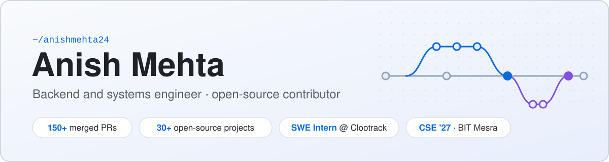

  <picture>
    <source media="(prefers-color-scheme: dark)" srcset="assets/header-dark.svg" />
    
  </picture>

  
  
  
  
  

## About

I'm a final-year CSE student at BIT Mesra and a software engineering intern at [Clootrack](https://www.clootrack.com/) (since Mar 2026), where I build Python and Go backend services for Clootrack Neo, a no-code analytics platform. Recent work: moving core services from Django to Go, replacing a Spark ingestion path with Polars, and regional Azure Blob caching for large exports.

Outside work I fix bugs in open source, mostly in LLM tooling, data pipelines and cloud-native infra. A typical PR: reproduce the bug, find where it comes from, fix it, and add a test that fails without the fix.

## Open source

| Project | Merged | One fix from there |
|---|:---:|---|
| [NVIDIA NeMo Agent Toolkit](https://github.com/NVIDIA/NeMo-Agent-Toolkit/pulls?q=is%3Apr+author%3Aanishmehta24+is%3Amerged) | 30+ | Ordering bugs in the agent graph scheduler ([#2507](https://github.com/NVIDIA/NeMo-Agent-Toolkit/pull/2507), [#2509](https://github.com/NVIDIA/NeMo-Agent-Toolkit/pull/2509)) |
| [Comet Opik](https://github.com/comet-ml/opik/pulls?q=is%3Apr+author%3Aanishmehta24+is%3Amerged) | 25+ | Open any LLM span in the playground ([#8725](https://github.com/comet-ml/opik/pull/8725)); close spans of unfinished generators ([#8518](https://github.com/comet-ml/opik/pull/8518)) |
| Microsoft agent-framework, [FLAML](https://github.com/microsoft/FLAML/pulls?q=is%3Apr+author%3Aanishmehta24+is%3Amerged), [Kiota](https://github.com/microsoft/kiota-python/pulls?q=is%3Apr+author%3Aanishmehta24+is%3Amerged) | 20+ | FLAML time-series forecasting on non-monthly panel data ([#1636](https://github.com/microsoft/FLAML/pull/1636)) |
| [ArviZ](https://github.com/arviz-devs/arviz-stats/pulls?q=is%3Apr+author%3Aanishmehta24+is%3Amerged), [PyMC](https://github.com/pymc-devs/pymc/pulls?q=is%3Apr+author%3Aanishmehta24+is%3Amerged), [PyTensor](https://github.com/pymc-devs/pytensor/pulls?q=is%3Apr+author%3Aanishmehta24+is%3Amerged) | 15+ | `initial` for `max` and `min` in PyTensor ([#2444](https://github.com/pymc-devs/pytensor/pull/2444)); multi-dimensional observations in LOO metrics ([#483](https://github.com/arviz-devs/arviz-stats/pull/483)) |
| [Apache Beam](https://github.com/apache/beam/pulls?q=is%3Apr+author%3Aanishmehta24+is%3Amerged) | 10 | NaN handling in DataFrame `drop_duplicates`, `duplicated` and `nunique` ([#40571](https://github.com/apache/beam/pull/40571)) |
| [AWS Powertools](https://github.com/aws-powertools/powertools-lambda-python/pulls?q=is%3Apr+author%3Aanishmehta24+is%3Amerged) | 7 | Skip non-finite metric values with a warning, in Python and TypeScript ([#8797](https://github.com/aws-powertools/powertools-lambda-python/pull/8797)) |
| [MLflow](https://github.com/mlflow/mlflow/pulls?q=is%3Apr+author%3Aanishmehta24+is%3Amerged) | 6 | Stop `EvaluationDataset.merge_records` from changing the caller's records ([#26730](https://github.com/mlflow/mlflow/pull/26730)) |
| [Kubeflow](https://github.com/kubeflow/trainer/pulls?q=is%3Apr+author%3Aanishmehta24+is%3Amerged) | 4 | Inject distributed-training env vars when a TrainJob omits `spec.trainer` ([#4082](https://github.com/kubeflow/trainer/pull/4082)) |

Also merged into [sqlglot](https://github.com/tobymao/sqlglot/pulls?q=is%3Apr+author%3Aanishmehta24+is%3Amerged), [Hugging Face Hub](https://github.com/huggingface/huggingface_hub/pulls?q=is%3Apr+author%3Aanishmehta24+is%3Amerged), [Keras](https://github.com/keras-team/keras/pulls?q=is%3Apr+author%3Aanishmehta24+is%3Amerged), [Jaeger](https://github.com/jaegertracing/jaeger/pulls?q=is%3Apr+author%3Aanishmehta24+is%3Amerged), [Vitess](https://github.com/vitessio/vitess/pulls?q=is%3Apr+author%3Aanishmehta24+is%3Amerged), [WasmEdge](https://github.com/WasmEdge/WasmEdge/pulls?q=is%3Apr+author%3Aanishmehta24+is%3Amerged), [Harbor](https://github.com/goharbor/harbor-cli/pulls?q=is%3Apr+author%3Aanishmehta24+is%3Amerged), [OpenKruise](https://github.com/openkruise/kruise/pulls?q=is%3Apr+author%3Aanishmehta24+is%3Amerged), [OpenVINO](https://github.com/openvinotoolkit/openvino/pulls?q=is%3Apr+author%3Aanishmehta24+is%3Amerged), [Prefect](https://github.com/PrefectHQ/prefect/pulls?q=is%3Apr+author%3Aanishmehta24+is%3Amerged), [Feast](https://github.com/feast-dev/feast/pulls?q=is%3Apr+author%3Aanishmehta24+is%3Amerged) and [CGAL](https://github.com/CGAL/cgal/pulls?q=is%3Apr+author%3Aanishmehta24+is%3Amerged).

**Every merged PR, refreshed daily:** [anishmehta24.github.io/oss-contributions](https://anishmehta24.github.io/oss-contributions/)

## Projects

<table>
  <tr>
    <td width="50%" valign="top">
      <h3><a href="https://github.com/anishmehta24/pcapdoctor">pcapdoctor</a></h3>
      

        
        
      

      
Reads a packet capture and explains in plain English what went wrong on the network: failed DNS lookups, refused or reset connections, packet loss, TLS handshake failures, and whether a slow request was the server or the network. Hand-written pcap, TCP/IP, DNS, TLS and X.509 parsers checked against Wireshark, plus Wireshark's filter language. <a href="https://github.com/anishmehta24/pcapdoctor/releases/latest">Release ↗</a>

    </td>
    <td width="50%" valign="top">
      <h3><a href="https://github.com/anishmehta24/microbox">MicroBox</a></h3>
      

        
        
      

      
A small Linux container runtime, built to learn what happens underneath Docker: namespaces, <code>pivot_root</code>, cgroups v2 resource limits, veth networking, and pulling and running OCI images.

    </td>
  </tr>
  <tr>
    <td width="50%" valign="top">
      <h3><a href="https://github.com/anishmehta24/isolab">IsoLab</a></h3>
      

        
        
      

      
A transaction isolation simulator: two-phase locking and MVCC engines, deadlock detection, a serializability checker, and a step-through visualizer that shows why an anomaly happens. <a href="https://anishmehta24.github.io/isolab/">Live ↗</a>

    </td>
    <td width="50%" valign="top">
      <h3><a href="https://github.com/anishmehta24/verse">Verse</a></h3>
      

        
        
      

      
A real-time collaborative workspace: docs, code, whiteboard and audio/video in one place. Yjs CRDTs over WebSockets for conflict-free editing, WebRTC calls with Socket.IO signalling. <a href="https://collab-docs-web.onrender.com/">Live ↗</a>

    </td>
  </tr>
</table>

Also: [OSS Contributor Engine](https://github.com/anishmehta24/OSS-Contributor-engine), a multi-agent app that matches your GitHub history to open-source issues (FastAPI, Next.js, pgvector).

## Toolbox

  

Plus Spark, Polars, DuckDB, Apache Beam, Dapr, Celery, pgvector and GitHub Actions.

## Latest pull requests

<!-- PRS:START -->
| Repository | Pull request | Status |
|---|---|---|
| [apache/beam](https://github.com/apache/beam) | [[Python] Make weighted ApproximateQuantiles independent of the weight scale](https://github.com/apache/beam/pull/41560) | <code>in&nbsp;review</code> |
| [apache/beam](https://github.com/apache/beam) | [[Python] Build a valid Duration proto for negative durations](https://github.com/apache/beam/pull/41558) | <code>merged</code> |
| [PrefectHQ/prefect](https://github.com/PrefectHQ/prefect) | [Quote attachment filenames in email_send_message](https://github.com/PrefectHQ/prefect/pull/23905) | <code>merged</code> |
| [feast-dev/feast](https://github.com/feast-dev/feast) | [fix: Keep the dataframe index out of write_to_offline_store](https://github.com/feast-dev/feast/pull/7160) | <code>merged</code> |
| [apache/libcloud](https://github.com/apache/libcloud) | [Route53: keep MX priority and SRV weight/port when updating or deleting records](https://github.com/apache/libcloud/pull/2224) | <code>in&nbsp;review</code> |
| [microsoft/FLAML](https://github.com/microsoft/FLAML) | [fix: compare the first lexicographic result with the incumbent in FLOW2](https://github.com/microsoft/FLAML/pull/1669) | <code>in&nbsp;review</code> |
<!-- PRS:END -->

Updated daily by a GitHub Action. Pull requests to my own and friends' repos are left out.

## Off the keyboard

Guitar, singing, and chasing boundaries on the cricket field.
